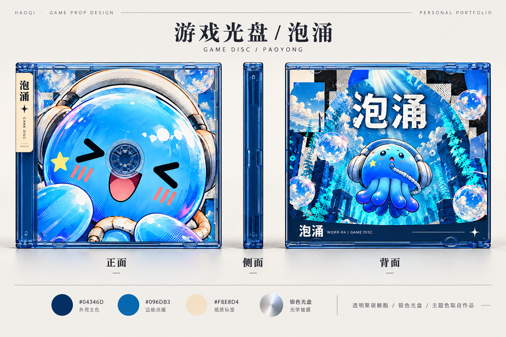
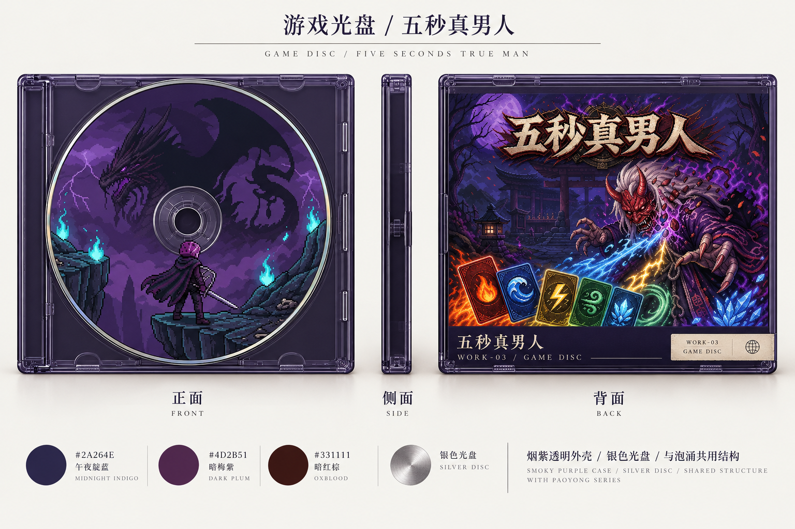
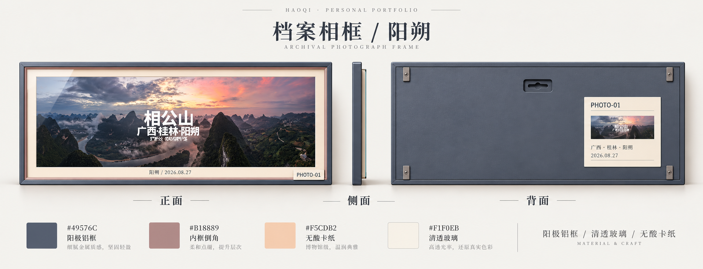
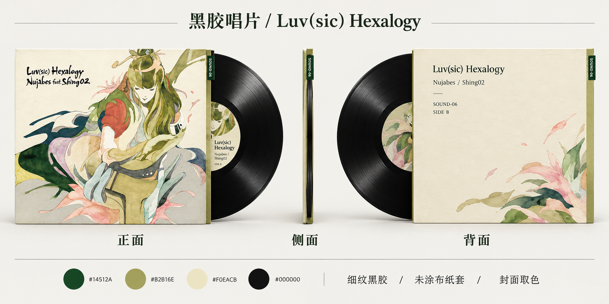

# 作品档案模型：第一版概念预览

当前为外观方案，网站内模型尚未替换。下列图片是内置 imagegen 结合实际素材生成的正面／侧面／背面设计图，并非已经完成的三维网格或严格工程图。

## 游戏光盘

采用薄型透明光盘盒，正面是大面积游戏图标盘贴，背面是宣传主视觉。根据作品改变外壳与标签的主题色；银色光盘边缘保留统一识别。

《泡涌》使用海蓝与奶油色；《五秒真男人》使用午夜靛蓝、暗梅紫及少量暗红。两者共享同一类盒体结构。

## 摄影档案相框

阳朔样本使用灰蓝金属框、晚霞粉内倒角、暖色无酸卡纸和清透玻璃。横向比例随原片；背面是固定夹与档案卡，保留地点和日期。

## 黑胶唱片

唱片与纸套作为一个组合，露出的黑胶轮廓明确区分游戏光盘。纸套从《Luv(sic) Hexalogy》封面取橄榄绿、深绿和暖纸色，保留黑胶纹理、盘芯和档案标签。

## 内容与主题色

初步色板通过实际图片采样，过滤过暗、近白和低饱和像素，再按 RGB 颜色区间聚类。色板由设计判断分配给框体、纸套和标签，图片本身不整体染色。黑胶与金属银属于材质色，不作为从封面提取出的颜色宣称。

| 内容 | 主题色 | 应用位置 |
| --- | --- | --- |
| 泡涌 | `#04346D`、`#096DB3`、`#F8E8D4` | 蓝色透明盒体、边框、奶油色档案标签 |
| 五秒真男人 | `#2A264E`、`#4D2B51`、`#331111` | 烟紫外壳、暗梅紫边缘、暗红小面积点缀 |
| 阳朔摄影 | `#49576C`、`#B18889`、`#F5CDB2` | 灰蓝铝框、晚霞粉倒角、暖色卡纸 |
| Luv(sic) Hexalogy | `#14512A`、`#B2B16E`、`#F0EACB` | 深绿档案签、橄榄绿纸套边缘、暖纸色背封 |

采样原始结果见 [extracted-colors.json](extracted-colors.json)。音乐参考图从本地 MP3 内嵌封面读取，其余图片直接使用项目现有素材。

完整生成提示词与引用图片路径见 [prompts.json](prompts.json)，工具为内置 imagegen，未调用外部 API 或 CLI。生成原件保留在 Codex 生成图片目录，当前文件夹保存了独立副本。

后续若选定方案，再制作实际 Three.js 模型：保留素材原图，统一盒体几何，按内容生成材质，并重新验证切换、旋转、抽取和归位。本次没有改动运行中的网页代码或模型。
